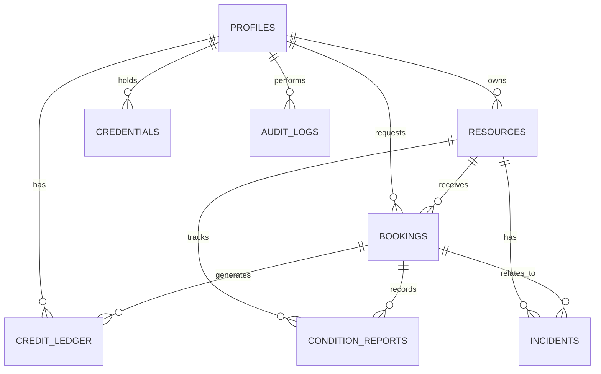
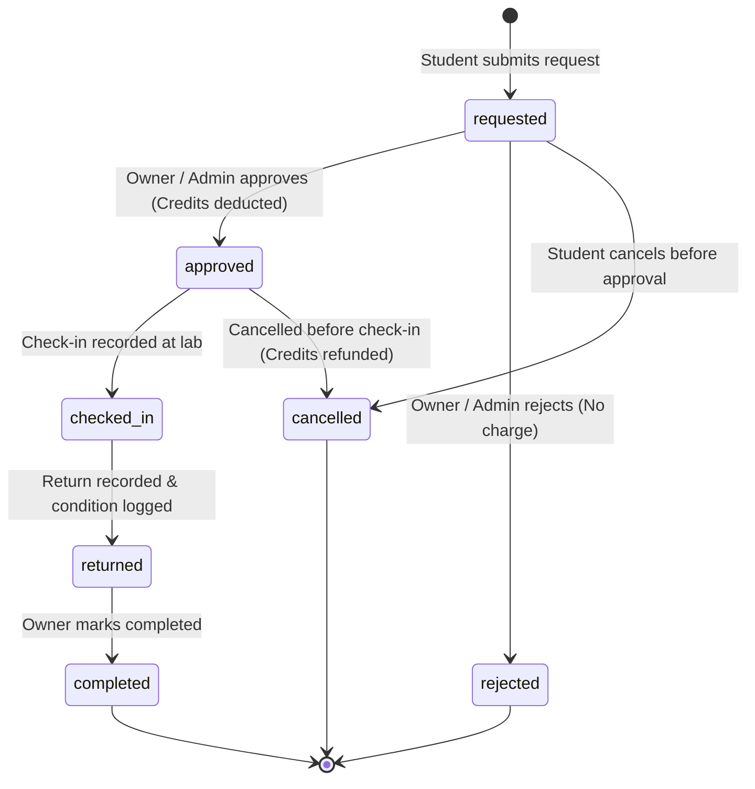

# LabLoop — Backend, Database & Booking System Architecture
**Role:** Member 2 — Backend, Database, Authentication & Security  
**Repository:** [https://github.com/parthsinghparihar32-art/LabLoop](https://github.com/parthsinghparihar32-art/LabLoop)  
**Branch:** `feat/backend-booking`  
**Base Target:** `main`

---

## 1. System Overview

LabLoop is a smart campus resource-sharing platform designed to make underutilized equipment, laboratories, and spaces accessible to students and researchers.

This document describes the backend architecture, PostgreSQL database schema, Supabase authentication integration, Row Level Security (RLS) policies, concurrency-safe booking engine, FairShare credit ledger, and shared API contracts developed for **Member 2**.

```text
                         USERS
            Students | Owners | Verifiers | Admins
                          │
                          ▼
                  NEXT.JS FRONTEND
            Catalogue │ Dashboard │ Booking
                          │
                          ▼
                SERVER-SIDE BACKEND
             Authentication & RBAC Context
             Zod Schema Validation & Error Masking
                          │
          ┌───────────────┼────────────────┐
          ▼               ▼                ▼
     Resources         Bookings       Credit Ledger
          │               │                │
          └───────────────┼────────────────┘
                          │
                          ▼
                 SUPABASE POSTGRESQL
              ┌────────────────────────┐
              │ 8 Core Tables          │
              │ GiST Exclusion Rules   │
              │ Row Level Security     │
              │ Atomic Stored Procs    │
              └────────────────────────┘
                          │
                          ▼
             Persistent Audit & Timeline
```

---

## 2. Database Schema (The Eight Core Tables)

All tables use ordered, version-controlled SQL migrations located in `supabase/migrations/`:

| # | Migration File | Table Name | Purpose |
|---|---|---|---|
| 1 | `20261029000001_create_profiles.sql` | `profiles` | User profiles linked to `auth.users(id)` with application roles |
| 2 | `20261029000002_create_resources.sql` | `resources` | Equipment, labs, and spaces available for booking |
| 3 | `20261029000003_create_bookings.sql` | `bookings` | Reservation requests, lifecycle, and GiST exclusion constraint |
| 4 | `20261029000004_create_credentials.sql` | `credentials` | Credential Passport records with anti-self-verification rule |
| 5 | `20261029000005_create_credit_ledger.sql` | `credit_ledger` | Append-only FairShare credit transactions with idempotency |
| 6 | `20261029000006_create_condition_reports.sql` | `condition_reports` | Equipment condition tracking at check-in and return |
| 7 | `20261029000007_create_incidents.sql` | `incidents` | Problem reports, damage tracking, and review outcomes |
| 8 | `20261029000008_create_audit_logs.sql` | `audit_logs` | Immutable security audit trail of privileged operations |
| 9 | `20261029000009_create_functions_and_triggers.sql` | *Procedures* | Atomic booking approval, credit deduction, and triggers |
| 10 | `20261029000010_configure_rls_policies.sql` | *Policies* | Comprehensive Row Level Security rules for all 8 tables |

### 2.1 Entity Relationship Diagram (ERD)



---

## 3. Booking Conflict Prevention & Concurrency Safety

### 3.1 The Problem
In campus environments, multiple students often attempt to book the same high-demand resource (e.g. 3D printer, confocal microscope) for the same time window. Naive checks (`SELECT WHERE ... THEN INSERT`) suffer from race conditions under concurrent requests.

### 3.2 The Solution: PostgreSQL GiST Exclusion Constraint
We leverage PostgreSQL's `btree_gist` extension to enforce mathematical non-overlapping intervals at the database kernel level:

```sql
CREATE EXTENSION IF NOT EXISTS btree_gist;

ALTER TABLE public.bookings ADD CONSTRAINT no_overlapping_approved_bookings
EXCLUDE USING gist (
    resource_id WITH =,
    tstzrange(start_time, end_time) WITH &&
) WHERE (status IN ('approved', 'checked_in'));
```

**Guarantees:**
- No two bookings for the same resource with overlapping `[start_time, end_time]` intervals can ever simultaneously exist with status `approved` or `checked_in`.
- Concurrent transactions racing to approve overlapping bookings will have one transaction succeed while the competing transaction is blocked or rejected immediately with PostgreSQL error code `23P01` (`exclusion_violation`).

### 3.3 Booking Lifecycle State Machine



---

## 4. FairShare Credit Ledger & Transaction Integrity

### 4.1 Immutable Ledger Design
The `credit_ledger` is strictly append-only. No `UPDATE` or `DELETE` permissions are granted to any authenticated client.

- **Positive amounts:** Credits granted or refunded.
- **Negative amounts:** Credits spent on approved bookings.
- **Balance Calculation:** Computed dynamically via `SUM(amount)` or cached through security-definer function `get_credit_balance(p_user_id)`.

### 4.2 Non-Negative Balance Enforcement
Before any deduction is executed, the user's ledger entries are locked with `FOR UPDATE` inside the database transaction:
```sql
SELECT COALESCE(SUM(amount), 0)::INTEGER
INTO v_current_balance
FROM public.credit_ledger
WHERE user_id = p_user_id
FOR UPDATE;

IF (v_current_balance + p_amount) < 0 THEN
    RAISE EXCEPTION 'INSUFFICIENT_CREDITS: User has % credits, deduction requires %', v_current_balance, ABS(p_amount);
END IF;
```

### 4.3 Idempotency Controls
Every transaction requires a unique `idempotency_key` (e.g., `booking-approve-<booking_id>`). If a network retry occurs, the transaction returns the existing transaction ID without double-charging or double-granting credits.

---

## 5. Credential Passport & Safety Verification

### 5.1 Anti-Self-Verification Rule
Students cannot verify their own credentials. This is enforced at two layers:
1. **Database Constraint:**
   ```sql
   CONSTRAINT check_no_self_verification CHECK (verified_by IS NULL OR verified_by <> user_id)
   ```
2. **Row Level Security & Service Layer:**
   Users with the `verifier` role can only verify credentials where `user_id <> auth.uid()`.

### 5.2 Resource Eligibility Gate
When booking a resource with `requires_credential` set (e.g., `'cleanroom_access'`), the backend automatically checks:
1. The user has a credential matching the exact credential type.
2. The credential's `verification_status` is `'verified'`.
3. The credential has not expired (`expires_at IS NULL OR expires_at > booking.end_time`).

---

## 6. Supabase Authentication & Role-Based Access Control (RBAC)

### 6.1 Application Roles
- `student`: Default role assigned upon self-registration. Can browse resources, submit booking requests, upload credentials, and view own ledger.
- `resource_owner`: Faculty or lab managers who own equipment. Can create resources, modify availability, approve/reject bookings, and mark bookings completed.
- `verifier`: Lab safety officers and certified trainers. Can verify or reject student credentials.
- `admin`: Platform administrators. Full visibility, audit inspection, credit grants, and system overrides.

### 6.2 Anti-Privilege Escalation
The `on_auth_user_created` trigger automatically inserts the user profile with `role = 'student'`, ignoring any role claimed in client signup metadata:
```sql
INSERT INTO public.profiles (id, full_name, role)
VALUES (NEW.id, v_full_name, 'student');
```
Furthermore, RLS on `profiles` prevents users from updating their own `role` field.

---

## 7. API Reference & Shared Team Contracts

All API endpoints return JSON conforming to the standardized envelope:
```json
{
  "success": true,
  "data": { ... },
  "metadata": {
    "timestamp": "2026-10-29T14:45:00.000Z",
    "total": 1,
    "page": 1,
    "pageSize": 20
  }
}
```

### 7.1 Resource Endpoints
- `GET /api/resources` — List resources with optional `?category=&status=&search=&page=&limit=`
- `POST /api/resources` — Create resource (*Owner/Admin*)
- `GET /api/resources/:id` — Retrieve resource details with owner info
- `PATCH /api/resources/:id` — Update resource (*Owner/Admin*)
- `DELETE /api/resources/:id` — Retire resource (*Owner/Admin*)

### 7.2 Booking Endpoints
- `GET /api/bookings` — List bookings with `?role_view=requester|owner|all&status=&page=&limit=`
- `POST /api/bookings` — Submit booking request
- `GET /api/bookings/:id` — Retrieve booking details
- `POST /api/bookings/:id/approve` — Approve booking (*Owner/Admin; deducts credits atomically*)
- `POST /api/bookings/:id/reject` — Reject booking (*Owner/Admin; optional reason*)
- `POST /api/bookings/:id/cancel` — Cancel booking (*Requester/Owner/Admin; refunds credits if approved*)
- `POST /api/bookings/:id/check-in` — Record lab check-in
- `POST /api/bookings/:id/return` — Record equipment return
- `POST /api/bookings/:id/complete` — Mark booking completed (*Owner/Admin*)

### 7.3 Credential Endpoints
- `GET /api/credentials` — List user's credentials
- `POST /api/credentials` — Submit new credential for review
- `PATCH /api/credentials/:id/verify` — Verify/Reject credential (*Verifier/Admin*)

### 7.4 FairShare Credit Endpoints
- `GET /api/credits/balance` — Get current user credit balance
- `GET /api/credits/history` — Get paginated transaction history
- `POST /api/credits/grant` — Grant credits to user (*Admin only*)

### 7.5 Condition Reports & Incidents
- `GET /api/condition-reports?resource_id=&booking_id=` — List condition history
- `POST /api/condition-reports` — Submit condition report (check-in/return)
- `GET /api/incidents` — List reported incidents
- `POST /api/incidents` — Report equipment issue or damage
- `PATCH /api/incidents/:id/review` — Review and resolve incident (*Verifier/Admin*)

### 7.6 Audit & System Health
- `GET /api/audit-logs` — List immutable security audit logs (*Admin only*)
- `GET /api/health` — Public health and schema status endpoint

---

## 8. Development & Testing Guide

### 8.1 Prerequisites
- Node.js >= 18
- npm

### 8.2 Environment Variables
Copy `.env.example` to `.env.local`:
```bash
cp .env.example .env.local
```
Fill in your Supabase project credentials:
```env
NEXT_PUBLIC_SUPABASE_URL=https://your-project.supabase.co
NEXT_PUBLIC_SUPABASE_ANON_KEY=your-anon-key
SUPABASE_SERVICE_ROLE_KEY=your-service-role-key
```

### 8.3 Executing Database Migrations
Run the migrations in sequential order using the Supabase CLI:
```bash
supabase db push
```
Alternatively, apply `supabase/schema.sql` directly into the Supabase SQL Editor.

### 8.4 Running Automated Tests
```bash
npm test            # Run all Vitest unit and security tests
npm run typecheck   # Validate TypeScript types
npm run build       # Build Next.js production bundle
```
